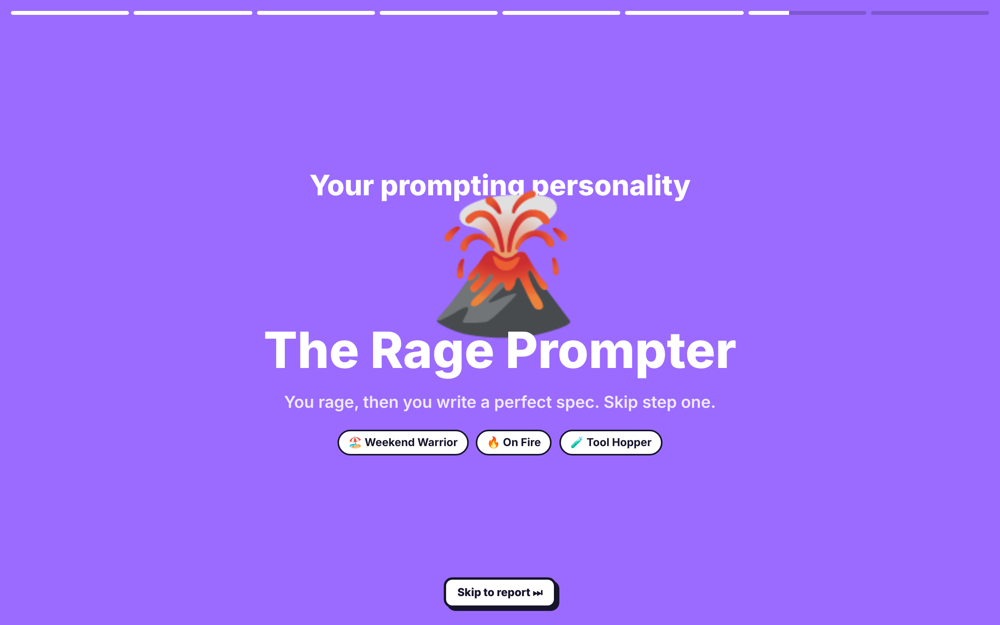
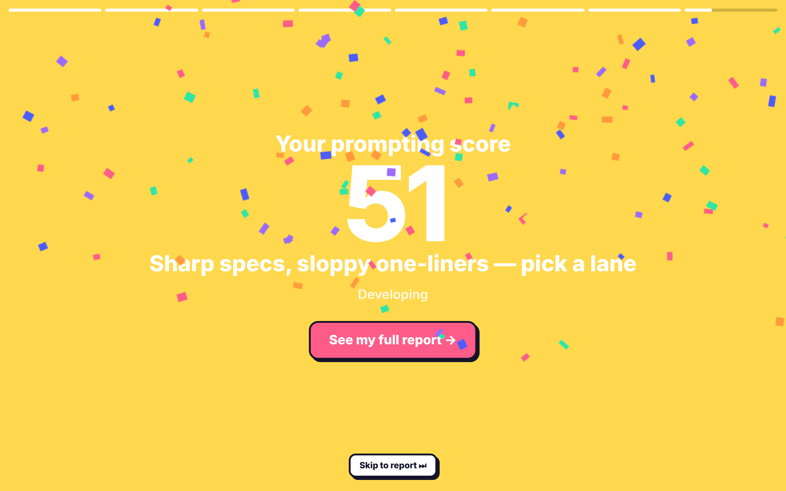
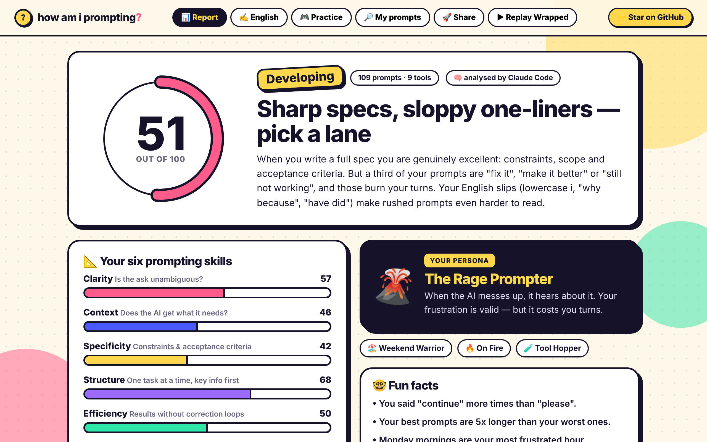
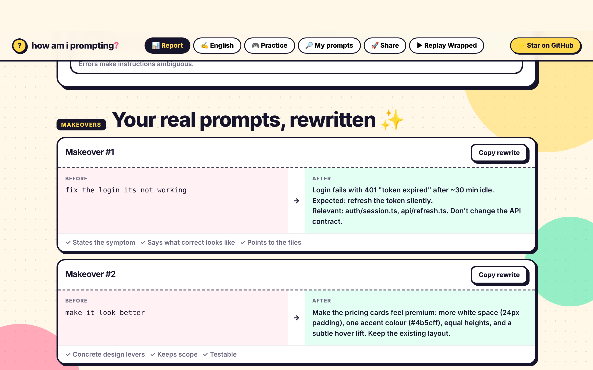

<div align="center">

# how am i prompting? 🤔

**Spotify Wrapped for your AI coding prompts.**
Find out how well you *really* talk to Claude Code, Codex, Cursor & friends — and get coached to do it better.

```bash
npx howamiprompting
```

100% local · no sign-up · free & open source · uses the AI you already have

 

</div>

---

## What it does

One command scans every AI coding chat on your machine, keeps **only what you typed**, and opens a beautiful local report:

- 🎬 **Your Wrapped** — prompts written, your AI crew, prime-time hour, catchphrases, rage moments, and your **prompting personality** (The Architect? The Yes-Machine? The Paste-and-Pray?)
- 📐 **A score across 6 skills** — Clarity · Context · Specificity · Structure · Efficiency · English
- ✨ **Makeovers of your real prompts** — your worst prompts, rewritten the way a senior engineer would write them
- ✍️ **Honest English feedback** — your actual grammar mistakes, corrected, with an estimated CEFR level (judged on your prose, never your code)
- 📌 **Stop repeating yourself** — finds instructions you type in every session ("use pnpm", "don't add comments") and turns them into a ready-to-paste `CLAUDE.md` / `AGENTS.md` / `.cursor/rules` / `GEMINI.md` / Copilot file
- 🗓️ **A personal prompt template + 7-day plan**
- 🎮 **Practice mode** — four timed mini-games generated from *your* weak spots (no paste, no spell-check)
- 📈 **Progress over time** — run it again next month and see your score move
- 🚀 **Share it** — a PNG score card for X / LinkedIn, or your **full report as a link or a single .html file** a teammate can open (the report is packed inside the link — nothing is uploaded)





## Supported tools

| Tool | Where we look |
|---|---|
| **Claude Code** | `~/.claude/projects/**.jsonl` |
| **OpenAI Codex CLI** | `~/.codex/sessions/**.jsonl` |
| **Gemini CLI** | `~/.gemini/tmp/*/logs.json`, `chats/` |
| **Cursor** (Chat, Composer, Agent) | Cursor's `state.vscdb` (read from a temp copy) |
| **VS Code Copilot Chat** | `workspaceStorage/*/chatSessions` |
| **Windsurf · Antigravity · Trae · Kiro · VSCodium** | same VS Code–family locations |
| **Cline · Roo Code · Kilo Code** | extension task histories |
| **Continue** | `~/.continue/sessions` |
| **OpenCode** | `~/.local/share/opencode/storage` |
| **Aider** | `.aider.chat.history.md` in your projects |
| **SpecStory** | `.specstory/history/*.md` |
| **Anything else** | `npx howamiprompting --include export.md` (Markdown, JSON, JSONL, text) |

Missing your tool? [Open an issue](https://github.com/theavijitsarkar/howamiprompting/issues) — or add a 30-line collector in [`cli/src/collect/`](cli/src/collect) and send a PR.

## How the analysis works

1. **Collect** — read-only scan of the locations above. Assistant replies, tool output, sub-agent traffic and system messages are dropped; pasted code and logs are replaced with markers like `[pasted log: 40 lines]`.
2. **Redact** — API keys, tokens, JWTs, private keys, passwords and DB URLs are stripped before anything else happens.
3. **Measure locally** — dozens of stats (length, timing, acknowledgements, frustration, context-giving, repeated instructions, English mechanics) computed on your machine. This alone gives you the Wrapped story and a heuristic score.
4. **Coach with your own AI** — a stratified sample (~180 prompts) goes to the agent **you already use**, in batches, then a synthesis pass writes the report. We auto-detect, in order:
   `claude` (Claude Code) → `codex` → `gemini` → `ANTHROPIC_API_KEY` → `OPENROUTER_API_KEY` → `OPENAI_API_KEY` → **Ollama** (fully offline)

You'll be asked before anything is sent. **An AI is required** — every score and insight comes from it. If none of the above works, the CLI walks you through setting one up (it can install Gemini CLI, Claude Code or Codex and open their login, or take an API key for one run). Want everything offline? Use Ollama.

## Privacy

- No account, no telemetry, no analytics in the CLI or the report.
- Your prompts are **never** sent to us. With an agent, the sample goes through *your own* Claude Code / Codex / Gemini / API key / local Ollama.
- The report runs on `127.0.0.1` with a random per-run token.
- History lives in `~/.howamiprompting/` — wipe it with `npx howamiprompting --reset`, or start over with `--fresh`.
- Sharing is serverless: share links carry the report inside the URL fragment (`#…`), which browsers never send to any server.

## Options

```
npx howamiprompting [options]

--agent <id>      claude | codex | gemini | anthropic | openrouter | openai | ollama
--model <name>    model override for that agent (e.g. haiku, sonnet)
--sample <n>      prompts sent for deep analysis (default 180)
--since <days>    only look at the last N days
--include <file>  also import a chat export (repeatable)
--roots <dir>     extra folder to search for Aider / SpecStory histories
--last            re-open your last report without rescanning
--fresh           delete saved history, then run a brand-new analysis
--reset           delete saved history (~/.howamiprompting) and exit
--json <file>     also write the report as JSON
--no-open         don't open the browser
-y, --yes         no questions
```

Requires Node.js 18.17+. Cursor history needs Node 22.5+ (built-in SQLite) **or** the `sqlite3` command (pre-installed on macOS).

## The six skills

| Skill | What great looks like |
|---|---|
| **Clarity** | One unambiguous goal. No "fix it", no "make it better". |
| **Context** | Current vs expected behaviour, relevant files, the *why*, errors with one line of your theory. |
| **Specificity** | Constraints, scope ("only touch X"), acceptance criteria, examples. |
| **Structure** | One task at a time, or numbered steps. Key info first. |
| **Efficiency** | Results without "still not working" loops and five rounds of "no, not like that". |
| **English** | Clear sentences, correct tense, real punctuation. Small grammar slips become ambiguous instructions. |

## Contributing

```bash
git clone https://github.com/theavijitsarkar/howamiprompting && cd howamiprompting/cli
node test/make-fixtures.js /tmp/fakehome          # fake histories for every tool
HOME=/tmp/fakehome node bin/howamiprompting.js   # needs an agent (claude/codex/gemini/API key/ollama)
```

Ideas that would be awesome: more collectors, better persona rules, translations of the report, more practice games.

## Who made this

Hi, I'm **[Avijit Sarkar](https://avijitsarkar.com)** — a founder from Kolkata building SaaS products like [GoDial](https://godial.cc) and [HyperScreenshot](https://hyperscreenshot.com). I talk to Claude Code and Codex all day, and wanted to know if I was any good at it. This is the tool I wished existed.

Say hi: [avijitsarkar.com](https://avijitsarkar.com)

## License

MIT © [Avijit Sarkar](https://avijitsarkar.com). If it helped you, a ⭐ helps other developers find it.
